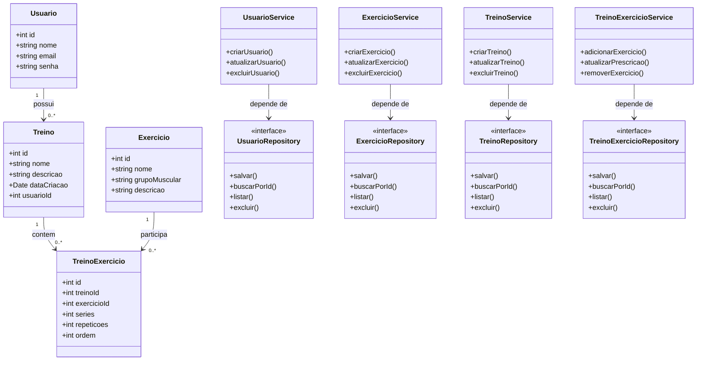

# Modelagem do Projeto 1 — FitPlan

## 1. Domínio do sistema

O FitPlan é um sistema de gerenciamento de treinos físicos que permite cadastrar usuários, exercícios e treinos personalizados. Cada treino pode conter vários exercícios, com informações sobre séries, repetições e ordem de execução. O objetivo é facilitar a organização e o acompanhamento dos treinos dos usuários.

## 2. Entidades, atributos e relacionamentos

### 2.1. Usuario

Representa uma pessoa cadastrada no sistema.

**Atributos:**
- `id`: identificador único do usuário.
- `nome`: nome completo.
- `email`: endereço de e-mail.
- `senha`: senha armazenada de forma segura.

**Relacionamento:** um usuário pode possuir vários treinos, mas cada treino pertence a um único usuário.

### 2.2. Exercicio

Representa um exercício físico disponível para ser incluído em treinos.

**Atributos:**
- `id`: identificador único do exercício.
- `nome`: nome do exercício.
- `grupoMuscular`: grupo muscular trabalhado.
- `descricao`: instruções para execução do exercício.

**Relacionamento:** um exercício pode estar presente em vários treinos.

### 2.3. Treino

Representa um treino criado para um usuário.

**Atributos:**
- `id`: identificador único do treino.
- `nome`: nome do treino.
- `descricao`: descrição do treino.
- `dataCriacao`: data de criação.
- `usuarioId`: identificador do usuário responsável pelo treino.

**Relacionamento:** cada treino pertence a um usuário e pode conter vários exercícios por meio da entidade TreinoExercicio.

### 2.4. TreinoExercicio

Representa a inclusão de um exercício em um treino, armazenando informações específicas daquela execução planejada.

**Atributos:**
- `id`: identificador único do registro.
- `treinoId`: identificador do treino.
- `exercicioId`: identificador do exercício.
- `series`: quantidade de séries planejadas.
- `repeticoes`: quantidade de repetições por série.
- `ordem`: posição do exercício no treino.

**Relacionamento:** cada registro pertence a um treino e referencia um exercício. Essa entidade permite que um treino tenha vários exercícios e que um mesmo exercício seja utilizado em diferentes treinos.

## 3. Diagrama de classes

## 4. Responsabilidades: Service e Repository

- **Usuario:** `UsuarioService` é responsável pelas regras de cadastro e atualização dos usuários. `UsuarioRepository` é responsável por persistir, consultar e excluir os dados dos usuários.
- **Exercicio:** `ExercicioService` gerencia as regras relacionadas aos exercícios. `ExercicioRepository` cuida do armazenamento e das consultas dos exercícios.
- **Treino:** `TreinoService` gerencia a criação e a atualização dos treinos, incluindo as regras relacionadas ao usuário responsável. `TreinoRepository` cuida da persistência e das consultas dos treinos.
- **TreinoExercicio:** `TreinoExercicioService` gerencia a inclusão, a alteração e a remoção de exercícios dos treinos, validando as informações necessárias. `TreinoExercicioRepository` cuida da persistência e das consultas desses registros.

Os services concentram as regras de negócio, enquanto os repositories concentram o acesso aos dados. As entidades representam os conceitos e atributos do domínio, sem assumir responsabilidades de persistência ou envio de notificações.

## 5. Aplicação dos princípios SRP e DIP

O princípio da Responsabilidade Única (SRP) é aplicado pela separação das responsabilidades entre entidades, services e repositories. Cada classe possui um papel definido: as entidades representam os dados do domínio, os services executam as regras de negócio e os repositories cuidam da persistência. Assim, uma alteração nas regras de negócio não exige necessariamente uma mudança na forma como os dados são armazenados.

O princípio da Inversão de Dependência (DIP) é aplicado fazendo com que os services dependam de interfaces de repository, em vez de dependerem diretamente de implementações concretas ou de um banco de dados. Dessa forma, é possível trocar a tecnologia de persistência sem precisar modificar as regras de negócio dos services.
